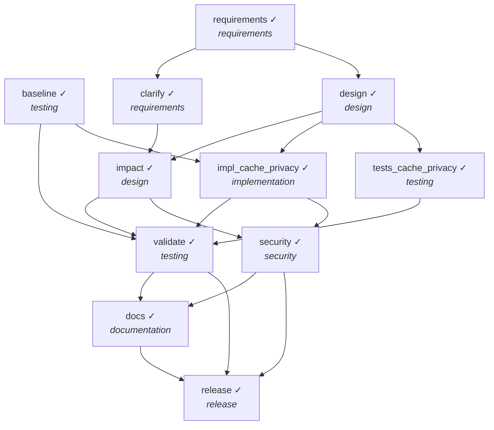

# Final Engineering Summary — Ambiguous: "make it faster and more private"

**Outcome:** `COMPLETED`

> Requirement: *Make the shortener faster and more private.*

## 1. Requirement understanding
- Normalized features: `core, cache, privacy_ip, admin_stats, scrub_legacy_ip` (status: **resolved**, requirement v2)
- **US-1** Shorten a URL and redirect to it — POST /shorten returns 201 with code+short_url; GET /{code} returns 302 to the target; non-http(s)/internal/oversized URLs are rejected with 422
- **US-2** Redirects are fast — hot links served from an in-process LRU cache; delete invalidates the cache; stale reads are TTL-bounded
- **US-3** Visitor IPs are not stored raw — clicks store a keyed hash, never the raw IP
- **US-4** Analytics restricted to admins — /stats requires X-Admin-Token; fails closed when unset
- **US-5** Existing raw IPs are removed — migration nulls previously stored raw IPs (irreversible)
- Ambiguity `speed`: What latency target (e.g. p95 redirect time) and traffic profile define 'faster'? → **resolved by human:** p95 redirect < 20 ms on read-heavy traffic; in-process caching is acceptable
- Ambiguity `privacy`: What must be private: visitor data (IPs), who can see analytics, or link targets? Is existing data in scope? → **resolved by human:** Do not store raw visitor IPs; only admins may see analytics; scrub raw IPs already stored

## 2. Plan and orchestration

Parallel layers (no dependency path inside a layer): `[['baseline', 'requirements'], ['clarify', 'design'], ['impact', 'impl_cache_privacy', 'tests_cache_privacy'], ['validate', 'security'], ['docs'], ['release']]`

| task | stage | depends on | status | attempts |
|---|---|---|---|---|
| baseline | testing | — | DONE | 1 |
| requirements | requirements | — | DONE | 1 |
| clarify | requirements | requirements | DONE | 1 |
| design | design | requirements | DONE | 2 |
| impact | design | design, clarify | DONE | 1 |
| validate | testing | baseline, impact, impl_cache_privacy, tests_cache_privacy | DONE | 2 |
| security | security | impact, impl_cache_privacy | DONE | 1 |
| docs | documentation | validate, security | DONE | 1 |
| release | release | validate, security, docs | DONE | 1 |
| impl_cache_privacy | implementation | design, baseline | DONE | 1 |
| tests_cache_privacy | testing | design | DONE | 2 |

## 3. Rationale and decision lineage

| # | task | decision | rationale | inputs | actor |
|---|---|---|---|---|---|
| 1 | requirements | normalized requirement | features=['core', 'cache', 'privacy_ip']; 2 ambiguity(ies), blocking=['speed', 'privacy'] |  | agent |
| 2 | clarify | clarification received | speed: p95 redirect < 20 ms on read-heavy traffic; in-process caching is acceptable; privacy: Do not store raw visitor IPs; only admins may see analytics; scrub raw IPs already stored |  | scripted-reviewer (SIMULATED human) |
| 3 | clarify | resolved ambiguities with human input | features now ['core', 'cache', 'privacy_ip', 'admin_stats', 'scrub_legacy_ip'] | {'requirements': 1} | agent |
| 4 | design | Random 7-char base62 codes with bounded collision retry | 62^7 ≈ 3.5e12 codes, non-enumerable, no coordination needed; sequential IDs rejected (guessable, needs a counter) | {'requirements': 2} | agent |
| 5 | design | In-process LRU with TTL, invalidated on delete | removes DB read from hot path; TTL bounds staleness if invalidation is missed | {'requirements': 2} | agent |
| 6 | design | Keyed HMAC of client IP instead of raw IP | keeps unique-visitor signal without storing personal data | {'requirements': 2} | agent |
| 7 | design | /stats gated by X-Admin-Token, fail-closed | analytics may reveal behaviour; breaking change to API contract, tests migrated | {'requirements': 2} | agent |
| 8 | design | One-time NULL-ing of raw IPs on startup migration | irreversible → requires explicit human approval | {'requirements': 2} | agent |
| 9 | impact | impact of 'cache_privacy' | modifies ['src/shortener/app.py', 'src/shortener/service.py', 'src/shortener/storage.py'], creates ['src/shortener/cache.py', 'src/shortener/privacy.py'], dependents [], serialised after nothing (parallel-safe) | {'requirements': 2, 'design': 1} | agent |
| 10 | impl_cache_privacy | approved change | owner confirms raw IPs have no business use; irreversible scrub accepted |  | scripted-reviewer (SIMULATED human) |
| 11 | validate | route failure to tests_cache_privacy | validation failed; repairing producer. RuntimeError: pytest: 2 failed, 23 passed in 0.47s; tests/test_api.py::test_shorten_redirect_stats_delete_flow - KeyError:...; tests/test_api.py::test_error_mapping - AssertionError: assert 401 == 404 |  | agent |
| 12 | tests_cache_privacy | migrated legacy tests | feedback showed tests/test_api.py encodes the old /stats contract; updated deliberately |  | agent |
| 13 | release | approved release | all gates green; privacy WARN resolved; /stats contract change communicated |  | scripted-reviewer (SIMULATED human) |

## 4. Artifacts

| artifact | version | hash | producer | built from |
|---|---|---|---|---|
| requirements | 1 | f0bfc2cc994e | requirements | — |
| requirements | 2 | 51ba5113456d | clarify | {'requirements': 1} |
| design | 1 | 9702112b4606 | design | {'requirements': 2} |
| impact | 1 | 8f27fbf7642a | impact | {'requirements': 2, 'design': 1} |
| baseline_report | 1 | d89cdcadb50f | baseline | — |
| security_report | 1 | 68e9f94a0cd8 | security | — |
| test_report | 1 | 12f7a30d4363 | validate | — |
| docs | 1 | 3f1984a5909f | docs | {'design': 1} |
| release | 1 | 0216621bd9c1 | release | — |

Workspace files:

- `README.md`
- `RELEASE_NOTES.md`
- `docs/API.md`
- `docs/DESIGN.md`
- `docs/openapi.json`
- `requirements.txt`
- `src/shortener/__init__.py`
- `src/shortener/app.py`
- `src/shortener/cache.py`
- `src/shortener/codec.py`
- `src/shortener/errors.py`
- `src/shortener/privacy.py`
- `src/shortener/service.py`
- `src/shortener/storage.py`
- `src/shortener/validation.py`
- `tests/conftest.py`
- `tests/test_api.py`
- `tests/test_cache_privacy.py`
- `tests/test_service.py`

## 5. Validation and risk control
- Tests: `25 passed in 0.44s`
- Security review: `[]`

Policy findings seen during the run:

- none

Human approvals:

| task | approved | approver | why approval was required | reason |
|---|---|---|---|---|
| impl_cache_privacy | True | scripted-reviewer (SIMULATED human) | src/shortener/storage.py: destructive/irreversible SQL in change | owner confirms raw IPs have no business use; irreversible scrub accepted |
| release | True | scripted-reviewer (SIMULATED human) | task is marked high-impact | all gates green; privacy WARN resolved; /stats contract change communicated |

## 6. Reliability metrics

| metric | value |
|---|---|
| tasks_total | 11 |
| tasks_done | 11 |
| task_success_rate | 1.0 |
| first_attempt_success_rate | 0.818 |
| retries | 1 |
| fallbacks | 0 |
| rollbacks | 1 |
| replans | 1 |
| policy_blocks | 0 |
| approvals | {'approved': 2, 'rejected': 0} |
| approval_wait_s | 0.0 |
| mttr_s | 0.823 |
| end_to_end_latency_s | 2.723 |

## 7. Risks and trade-offs

| risk / trade-off | mitigation / decision |
|---|---|
| Agent guesses what 'private' means and ships the wrong thing | blocking ambiguity -> human checkpoint; design/implementation built on the draft are discarded and re-planned |
| Irreversible scrub of stored IPs | destructive-SQL policy rule forces explicit human approval before commit |
| Breaking API change (/stats now needs a token) | fails closed; legacy tests migrated only after failure feedback, audit-visible |
| Trade-off: cache staleness | LRU+TTL (60 s) bounds staleness; delete invalidates explicitly |

## 8. Assumptions

- Answers to blocking questions come from a human owner (simulated reviewer in the demo run).
- In-process cache is acceptable because the service is single-node.

## 9. Limitations

- Hash salt is per-process unless VISITOR_SALT is set: unique-visitor counts reset on restart.
- Column is still named `ip` (holds a hash); renaming is a separate migration.
- Cache is per-node.

## 10. Audit
- `audit.jsonl`: 70 hash-chained records — **chain intact**
