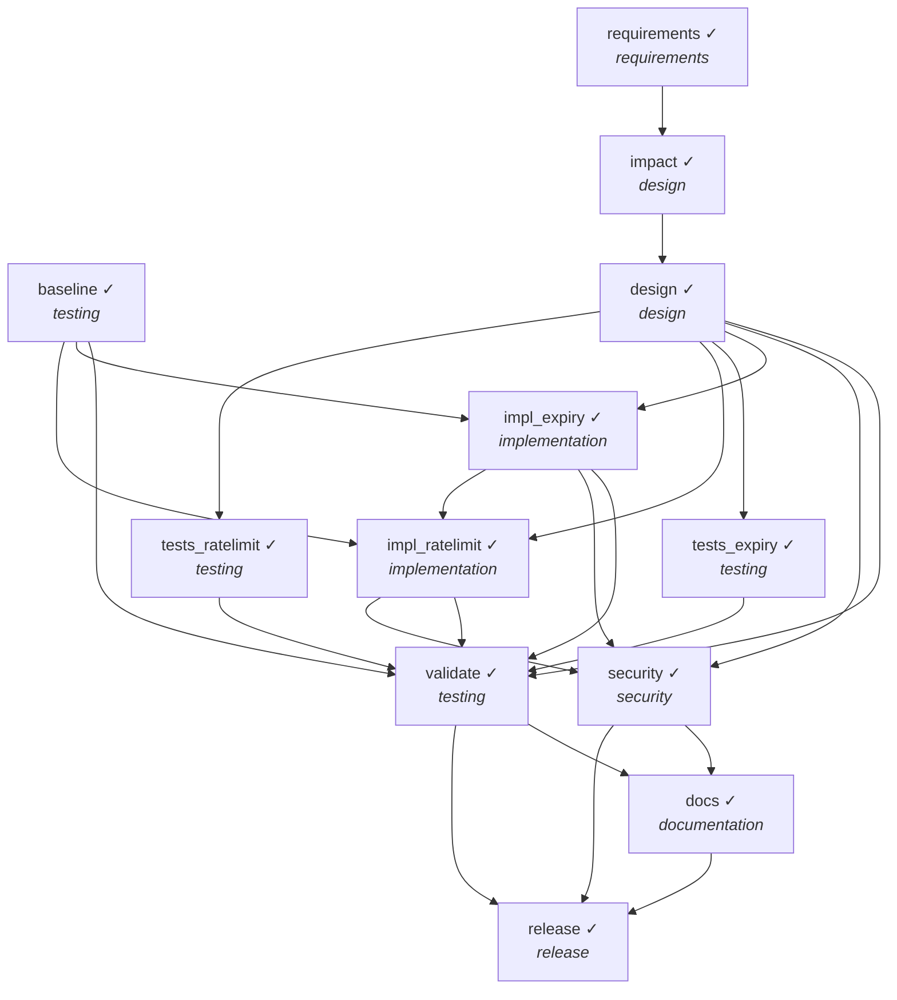

# Final Engineering Summary — Brownfield: link expiry + rate limiting on an existing shortener

**Outcome:** `COMPLETED`

> Requirement: *Add optional link expiry (TTL) and rate limiting on link creation to curb abuse, without breaking existing clients or data.*

## 1. Requirement understanding
- Normalized features: `expiry, ratelimit` (status: **resolved**, requirement v1)
- **US-1** Links can expire — ttl_seconds optional on create; expired link returns 410; existing links/DBs keep working (migration is additive)
- **US-2** Protect link creation from abuse — per-client token bucket on POST /shorten; 429 with Retry-After when exhausted; redirects are never rate limited

## 2. Plan and orchestration

Parallel layers (no dependency path inside a layer): `[['baseline', 'requirements'], ['impact'], ['design'], ['impl_expiry', 'tests_expiry', 'tests_ratelimit'], ['impl_ratelimit'], ['validate', 'security'], ['docs'], ['release']]`

| task | stage | depends on | status | attempts |
|---|---|---|---|---|
| baseline | testing | — | DONE | 1 |
| requirements | requirements | — | DONE | 1 |
| impact | design | requirements | DONE | 1 |
| design | design | impact | DONE | 1 |
| validate | testing | baseline, design, impl_expiry, tests_expiry, impl_ratelimit, tests_ratelimit | DONE | 1 |
| security | security | design, impl_expiry, impl_ratelimit | DONE | 1 |
| docs | documentation | validate, security | DONE | 1 |
| release | release | validate, security, docs | DONE | 1 |
| impl_expiry | implementation | design, baseline | DONE | 1 |
| tests_expiry | testing | design | DONE | 1 |
| impl_ratelimit | implementation | design, baseline, impl_expiry | DONE | 1 |
| tests_ratelimit | testing | design | DONE | 1 |

## 3. Rationale and decision lineage

| # | task | decision | rationale | inputs | actor |
|---|---|---|---|---|---|
| 1 | requirements | normalized requirement | features=['expiry', 'ratelimit']; 0 ambiguity(ies), blocking=[] |  | agent |
| 2 | impact | impact of 'expiry' | modifies ['src/shortener/app.py', 'src/shortener/errors.py', 'src/shortener/service.py', 'src/shortener/storage.py', 'src/shortener/validation.py'], creates [], dependents [], serialised after nothing (parallel-safe) | {'requirements': 1} | agent |
| 3 | impact | impact of 'ratelimit' | modifies ['src/shortener/app.py'], creates ['src/shortener/ratelimit.py'], dependents [], serialised after ['impl_expiry'] | {'requirements': 1} | agent |
| 4 | design | Lazy expiry on read (410 Gone), additive column migration | no sweeper to operate; old DBs upgrade in place without data loss | {'requirements': 1, 'impact': 1} | agent |
| 5 | design | In-process per-IP token bucket on POST /shorten only | cheap and dependency-free; per-node and does not trust X-Forwarded-For (documented limit) | {'requirements': 1, 'impact': 1} | agent |
| 6 | release | approved release | backward-compatible; additive migration; tests green |  | scripted-reviewer (SIMULATED human) |

## 4. Artifacts

| artifact | version | hash | producer | built from |
|---|---|---|---|---|
| requirements | 1 | 8b29ad833d0b | requirements | — |
| impact | 1 | 35db9ffa2e6c | impact | {'requirements': 1} |
| design | 1 | ea77924c0ac7 | design | {'requirements': 1, 'impact': 1} |
| baseline_report | 1 | 0b9b78f01801 | baseline | — |
| security_report | 1 | 65c6d32c72e1 | security | — |
| test_report | 1 | 2f6bc20a7b1d | validate | — |
| docs | 1 | 2b658a2b6a69 | docs | {'design': 1} |
| release | 1 | 2aadab8a146d | release | — |

Workspace files:

- `README.md`
- `RELEASE_NOTES.md`
- `docs/API.md`
- `docs/DESIGN.md`
- `docs/openapi.json`
- `requirements.txt`
- `src/shortener/__init__.py`
- `src/shortener/app.py`
- `src/shortener/codec.py`
- `src/shortener/errors.py`
- `src/shortener/ratelimit.py`
- `src/shortener/service.py`
- `src/shortener/storage.py`
- `src/shortener/validation.py`
- `tests/conftest.py`
- `tests/test_api.py`
- `tests/test_expiry.py`
- `tests/test_ratelimit.py`
- `tests/test_service.py`

## 5. Validation and risk control
- Tests: `32 passed in 0.45s`
- Security review: `['[WARN] P-COMP-001 src/shortener/service.py: raw client IP (personal data) is persisted']`

Policy findings seen during the run:

- none

Human approvals:

| task | approved | approver | why approval was required | reason |
|---|---|---|---|---|
| release | True | scripted-reviewer (SIMULATED human) | task is marked high-impact | backward-compatible; additive migration; tests green |

## 6. Reliability metrics

| metric | value |
|---|---|
| tasks_total | 12 |
| tasks_done | 12 |
| task_success_rate | 1.0 |
| first_attempt_success_rate | 1.0 |
| retries | 0 |
| fallbacks | 0 |
| rollbacks | 0 |
| replans | 0 |
| policy_blocks | 0 |
| approvals | {'approved': 1, 'rejected': 0} |
| approval_wait_s | 0.0 |
| mttr_s | None |
| end_to_end_latency_s | 2.081 |

## 7. Risks and trade-offs

| risk / trade-off | mitigation / decision |
|---|---|
| Schema change on a live DB | additive ALTER TABLE only, forward-only, tested against a legacy-schema DB file |
| Two features edit the same file (app.py) | impact analysis serialises overlapping changes; disjoint ones run in parallel |
| Rate limiter memory growth | LRU-bounded bucket map (10k keys) |
| Trade-off: in-process limiter | no extra infra, but per-node; Redis-backed limiter is the multi-node path |

## 8. Assumptions

- Existing clients must keep working: new request fields are optional, old DBs are upgraded in place.
- Rate limit keyed by direct client IP; deployment is behind no trusted proxy.

## 9. Limitations

- Limiter ignores X-Forwarded-For (would be spoofable if trusted blindly).
- Expiry is lazy (checked on read); expired rows are not purged.
- Failure→producer routing is heuristic (test file name → feature).

## 10. Audit
- `audit.jsonl`: 52 hash-chained records — **chain intact**
