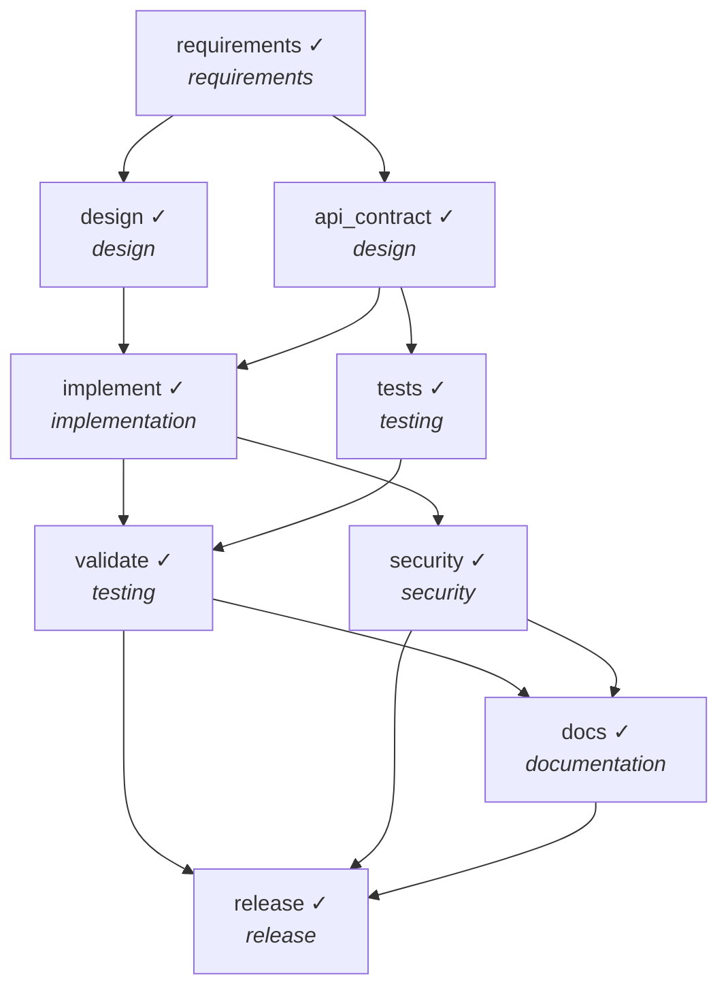

# Final Engineering Summary — Greenfield: URL shortener service

**Outcome:** `COMPLETED`

> Requirement: *Build a URL shortener service from scratch with core APIs (shorten, redirect, custom alias, delete), analytics, and reliability features.*

## 1. Requirement understanding
- Normalized features: `core, alias, analytics, reliability` (status: **resolved**, requirement v1)
- **US-1** Shorten a URL and redirect to it — POST /shorten returns 201 with code+short_url; GET /{code} returns 302 to the target; non-http(s)/internal/oversized URLs are rejected with 422
- **US-2** Choose a custom alias — valid alias is honoured; duplicate alias returns 409; reserved/invalid alias returns 422
- **US-3** See click analytics for a link — GET /stats/{code} returns total clicks, last access, clicks per day
- **US-4** Operate the service safely — GET /healthz reports liveness; code collisions are retried a bounded number of times; DELETE /links/{code} removes link and its analytics
- Ambiguity `reliability`: What availability / error budget applies? → assumed: health endpoint, bounded retries, idempotent delete, input validation

## 2. Plan and orchestration

Parallel layers (no dependency path inside a layer): `[['requirements'], ['design', 'api_contract'], ['implement', 'tests'], ['validate', 'security'], ['docs'], ['release']]`

| task | stage | depends on | status | attempts |
|---|---|---|---|---|
| requirements | requirements | — | DONE | 1 |
| design | design | requirements | DONE | 1 |
| api_contract | design | requirements | DONE | 1 |
| implement | implementation | design, api_contract | DONE | 1 |
| tests | testing | api_contract | DONE | 1 |
| validate | testing | implement, tests | DONE | 1 |
| security | security | implement | DONE | 1 |
| docs | documentation | validate, security | DONE | 1 |
| release | release | validate, security, docs | DONE | 1 |

## 3. Rationale and decision lineage

| # | task | decision | rationale | inputs | actor |
|---|---|---|---|---|---|
| 1 | requirements | normalized requirement | features=['core', 'alias', 'analytics', 'reliability']; 1 ambiguity(ies), blocking=[] |  | agent |
| 2 | api_contract | API contract derived from stories | 6 operations | {'requirements': 1} | agent |
| 3 | design | Random 7-char base62 codes with bounded collision retry | 62^7 ≈ 3.5e12 codes, non-enumerable, no coordination needed; sequential IDs rejected (guessable, needs a counter) | {'requirements': 1} | agent |
| 4 | design | Alias = [A-Za-z0-9_-]{3,32}, minus reserved route names | prevents route shadowing (/stats, /healthz) and homoglyph abuse | {'requirements': 1} | agent |
| 5 | design | One row per click, aggregated on read | simple and exact; write-per-redirect cost accepted at prototype scale (roadmap: async batching) | {'requirements': 1} | agent |
| 6 | design | 302 (not 301) redirects + strict URL validation | 301 is cached by browsers and would bypass analytics/expiry/delete; validation blocks non-http(s) and internal targets | {'requirements': 1} | agent |
| 7 | implement | approved change | reviewed evidence; within risk appetite |  | scripted-reviewer (SIMULATED human) |
| 8 | release | approved release | tests+security green; accepts WARN P-COMP-001 (raw IP) for this prototype; tracked for remediation |  | scripted-reviewer (SIMULATED human) |

## 4. Artifacts

| artifact | version | hash | producer | built from |
|---|---|---|---|---|
| requirements | 1 | e370ed3e6e31 | requirements | — |
| api_contract | 1 | 97f8835274e4 | api_contract | {'requirements': 1} |
| design | 1 | d787777972e3 | design | {'requirements': 1} |
| security_report | 1 | 2233fa10bcfd | security | — |
| test_report | 1 | 7954bcd01a74 | validate | — |
| docs | 1 | 3f1984a5909f | docs | {'design': 1} |
| release | 1 | 2aadab8a146d | release | — |

Workspace files:

- `README.md`
- `RELEASE_NOTES.md`
- `docs/API.md`
- `docs/DESIGN.md`
- `docs/openapi.json`
- `requirements.txt`
- `src/shortener/__init__.py`
- `src/shortener/app.py`
- `src/shortener/codec.py`
- `src/shortener/errors.py`
- `src/shortener/service.py`
- `src/shortener/storage.py`
- `src/shortener/validation.py`
- `tests/conftest.py`
- `tests/test_api.py`
- `tests/test_service.py`

## 5. Validation and risk control
- Tests: `20 passed in 0.36s`
- Security review: `['[WARN] P-COMP-001 src/shortener/service.py: raw client IP (personal data) is persisted']`

Policy findings seen during the run:

| rule | severity | path | message |
|---|---|---|---|
| P-COMP-001 | warn | src/shortener/service.py | raw client IP (personal data) is persisted |

Human approvals:

| task | approved | approver | why approval was required | reason |
|---|---|---|---|---|
| implement | True | scripted-reviewer (SIMULATED human) | requirements.txt: protected path (change control) | reviewed evidence; within risk appetite |
| release | True | scripted-reviewer (SIMULATED human) | task is marked high-impact | tests+security green; accepts WARN P-COMP-001 (raw IP) for this prototype; tracked for remediation |

## 6. Reliability metrics

| metric | value |
|---|---|
| tasks_total | 9 |
| tasks_done | 9 |
| task_success_rate | 1.0 |
| first_attempt_success_rate | 1.0 |
| retries | 0 |
| fallbacks | 0 |
| rollbacks | 0 |
| replans | 0 |
| policy_blocks | 0 |
| approvals | {'approved': 2, 'rejected': 0} |
| approval_wait_s | 0.0 |
| mttr_s | None |
| end_to_end_latency_s | 1.105 |

## 7. Risks and trade-offs

| risk / trade-off | mitigation / decision |
|---|---|
| Open redirect / SSRF-style abuse via malicious targets | scheme allowlist, credential and internal-address rejection at creation; 302 only |
| Raw client IP stored for analytics (personal data) | policy rule P-COMP-001 flags it as a WARN, carried into release approval; remediated in the ambiguous scenario |
| Collision on random codes | bounded retry then 503; 62^7 code space |
| Trade-off: write-per-click analytics | exact and simple now; async batching is the scale path |

## 8. Assumptions

- Single-node deployment; SQLite is acceptable persistence for a prototype.
- URLs are public web resources; no authentication is required to create links (rate limiting is a brownfield follow-up).
- reliability: assumed 'health endpoint, bounded retries, idempotent delete, input validation'

## 9. Limitations

- DNS-based SSRF (hostname resolving to a private IP) is not checked.
- SQLite single-writer: not horizontally scalable; no auth on delete/create.
- Generation is template-driven; an LLM agent can replace it behind the same agent interface.

## 10. Audit
- `audit.jsonl`: 46 hash-chained records — **chain intact**
